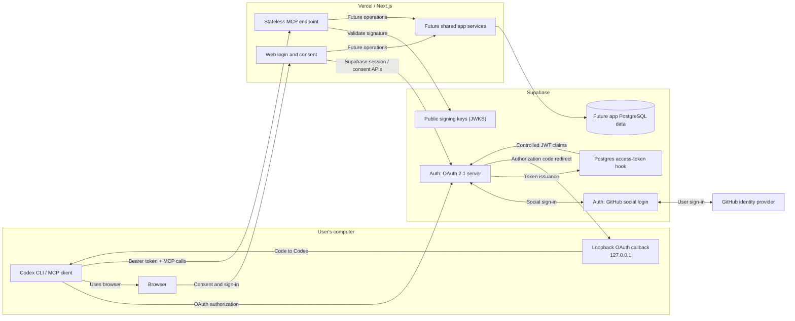
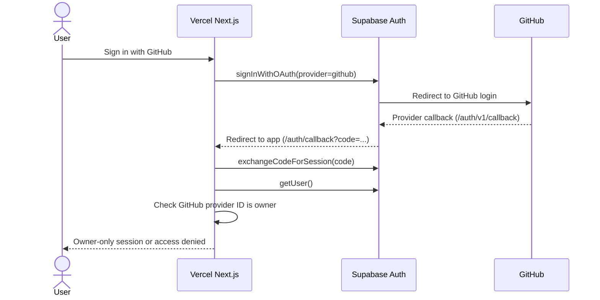
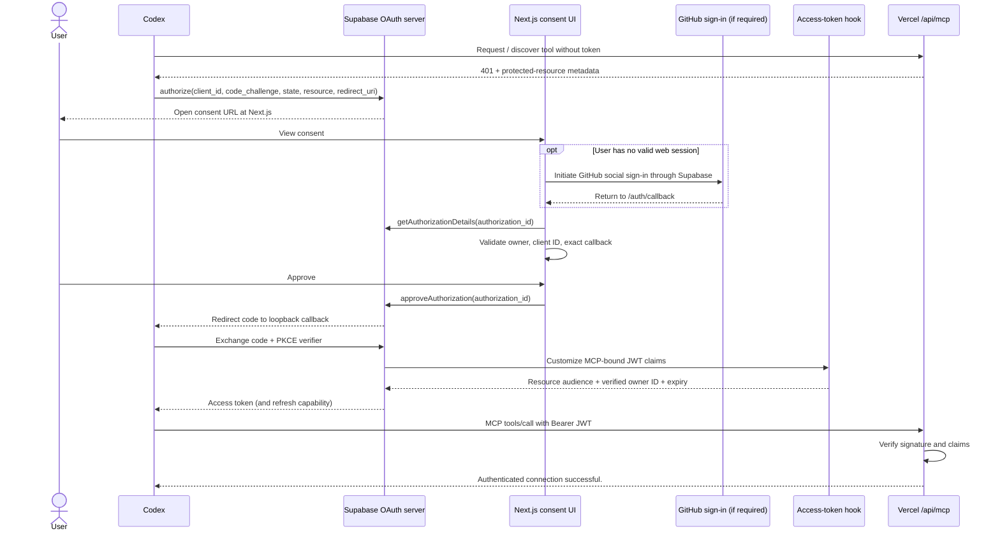

# Remote MCP authentication architecture

> **Scope:** The isolated Codex ↔ Supabase OAuth 2.1 ↔ Vercel compatibility spike, not the full AI Development Workspace.
>
> **Decision baseline:** [Technical specification v0.2](technical-spec-v0.2.md). **Practical setup:** [Remote MCP setup guide](../guides/remote-mcp-setup.md). **Implementation and results:** [Spike README](../../spikes/remote-mcp/README.md).
>
> **Status (2026-10-17):** Browser login, Codex OAuth authorization and an authenticated remote MCP tool call succeeded. The user also reported that a later tool call still worked after waiting and restarting Codex. Token-refresh internals, non-owner rejection and revocation were not independently tested.

## 1. The problem we are solving

AI Development Workspace needs two interfaces to the *same* application: a human-facing web UI and an agent-facing Model Context Protocol (MCP) endpoint. Codex must be able to request permitted planning operations from its normal CLI without storing Supabase service keys, GitHub secrets or direct database credentials. The web UI and MCP endpoint will eventually call the same authorization-aware application services.

Think of this in four questions:

| Question | Answer in this architecture |
| --- | --- |
| **Who is the human?** | Supabase Auth verifies a GitHub sign-in and the app checks the stable GitHub provider user ID. |
| **Which client is connecting?** | Codex is a **public OAuth client** registered in the Supabase OAuth Apps section. |
| **May that client call this resource?** | Supabase's OAuth 2.1 authorization server handles consent and issues a token intended for our MCP endpoint. |
| **What may the request do?** | The MCP endpoint validates the token and enforces application/tool-level permissions; a valid login alone never authorizes every possible action. |

**Do not confuse the two OAuth applications.** A *GitHub OAuth App* establishes the user's identity via GitHub → Supabase. A *Supabase OAuth App* identifies **Codex as a client** asking to access the MCP resource. Both exist in the same login journey, but they have different client IDs and redirect URIs.

## 2. Components and trust boundaries

**Today:** Only the read-only `connection_test` MCP tool is implemented. The future application services, product tables, agent runner and GitHub repository integration are *not* implemented by this spike. The browser UI and MCP route share a Next.js deployment, but authentication decisions and tokens come from Supabase.

**Why stateless?** Each MCP request carries a signed access token, so the Vercel route does not need sticky sessions, an in-memory login table or a running local web server. JWT verification happens on each call. Future stateful tasks, approvals and run history belong in PostgreSQL, not in MCP process memory.

## 3. Concepts, in plain language

| Term | Meaning here |
| --- | --- |
| **MCP (Model Context Protocol)** | The protocol through which Codex discovers and invokes tools exposed by our server. It is *not* itself a user database or login provider. |
| **Streamable HTTP** | The network transport used by the remote `/api/mcp` endpoint. Codex connects over HTTPS; it does not start a local MCP server process. |
| **OAuth 2.1 authorization server** | Supabase Auth: manages the authorization request, consent, code exchange and token issuance. |
| **OAuth client** | Codex: an app requesting delegated access to a protected resource. The client ID identifies it but is **not** a secret. |
| **Resource server** | Our Vercel MCP endpoint: receives tokens and decides whether a request is authorized. It does not mint access tokens. |
| **Public OAuth client** | A client like a locally running CLI that cannot safely protect a built-in client secret; it uses authorization-code flow with PKCE. |
| **PKCE (S256)** | Codex creates a secret verifier and sends a hashed challenge; exchanging the returned code requires the original verifier. A stolen authorization code alone is insufficient. |
| **State** | An opaque value binding the authorization response to the login attempt, helping prevent response mix-ups and CSRF. |
| **Redirect URI** | The *exact* loopback destination to which Supabase returns the authorization code for Codex. It is distinct from GitHub's redirect to Supabase. |
| **JWT** | A signed access-token representation containing issuer, audience, expiry, subject and authorization claims. A JWT is not encrypted by default: never log or commit it. |
| **JWKS** | Supabase's public signing keys; our MCP server uses them to verify JWT signatures without keeping private signing keys. |
| **Audience (`aud`)** | The resource for which a token was issued. Requiring the exact MCP URL prevents a normal browser-login token from being reused as an MCP credential. |
| **Refresh token** | A credential Codex can use to request a fresh access token without asking the human to approve every tool call; its actual refresh behavior must be verified separately. |

## 4. Two different login paths

### A. Human signs into the web app

GitHub's registered authorization callback is **the Supabase `/auth/v1/callback` URL**. Supabase in turn redirects the browser to **the Next.js `/auth/callback` URL**. The app checks the numeric provider ID, not the mutable GitHub username or browser-supplied profile metadata.

### B. Codex obtains permission to call the MCP endpoint

The consent page receives an **opaque `authorization_id`**, not necessarily a UUID. This was discovered live and is now covered by `tests/oauth.test.ts`. The page checks its bounded URL-safe shape; the Supabase `getAuthorizationDetails()` API determines whether it refers to a real, unexpired request. The user must then explicitly approve or deny it. Codex's loopback server runs on the user's machine; Vercel does not need to reach the user's localhost.

## 5. Why we customize the JWT

A normal Supabase session token typically has `aud = authenticated`. That is not enough to prove the token was issued *to access our MCP endpoint*. The **Custom Access Token Postgres hook** runs during token issuance:

1. When the JWT's `client_id` matches our registered Codex OAuth client, it queries `auth.identities` for the configured GitHub provider identity on the authenticated user.
2. It refuses to issue an authorized MCP token if that owner identity is absent.
3. It writes `github_provider_id` from the database (not `user_metadata`), changes `aud` to the canonical `https://<host>/api/mcp`, and caps `exp` at `iat + 300` seconds.
4. For other clients, it preserves the ordinary audience and does not grant this MCP-specific owner claim.

The Vercel endpoint independently checks: the JWT signature (JWKS, ES256/RS256), `iss`, exact `aud`, `sub` (Supabase UUID), expiry and maximum token age, the allowlisted `client_id`, verified `github_provider_id`, authenticated role and non-anonymous status. Failed checks return HTTP **401** without exposing a secret. The current handler permits only `connection_test`; future tools must additionally enforce per-task permissions through application services.

The SQL template is [here](../../spikes/remote-mcp/supabase/custom-access-token-hook.sql). It is a **template**, not a checked-in copy of the configured hook or a production migration. The live hook was applied separately to the isolated Supabase project.

## 6. Callback identity, client identity and URLs

The same flow has three easy-to-confuse URLs:

| Purpose | Shape |
| --- | --- |
| GitHub → Supabase social-login callback | `https://<project>.supabase.co/auth/v1/callback` |
| Supabase → Next.js web-session callback | `https://<app>/auth/callback` (sometimes with `authorization_id`) |
| Supabase → Codex OAuth callback | `http://127.0.0.1:<fixed-port>/callback/<client-generated-id>` |

The Codex callback must match **three places**: Codex's actual listener URL, the redirect URI registered for the *Supabase OAuth App*, and `MCP_OAUTH_REDIRECT_URI` in the Vercel application. The callback suffix can vary by Codex registration; copying a generic `/callback` is not sufficient. The app's canonical HTTPS origin simultaneously determines the MCP audience and OAuth resource metadata.

The **GitHub Client ID** must never be substituted for the **Supabase OAuth App Client ID**. They are issued by different systems.

## 7. Security choices and remaining limits

- **Least privilege:** Codex receives a public OAuth client ID, not the GitHub OAuth secret, Supabase service-role key or database connection string.
- **Separation of duties:** GitHub establishes identity; Supabase issues delegated authorization; MCP verifies access; application services will enforce task transitions and human approvals. A valid token never authorizes a model to approve its own work.
- **No arbitrary redirects:** The server checks the client ID and exact redirect URI before consent; the post-consent redirect must remain on the expected loopback origin and path.
- **Bounded exposure:** MCP JWTs expire within five minutes, so a revoked consent or refresh token might still leave an already-issued JWT usable for up to that window. Immediate revocation needs additional machinery.
- **Public discovery, protected tools:** Metadata and the 401 challenge must remain accessible without Vercel's deployment-login protection. The MCP tools themselves still require valid Bearer credentials.
- **Separate future runner:** Vercel handles short HTTP requests, not long-running agent execution. Durable orchestration and an isolated runner are later milestones.

**Observed live:** GitHub sign-in, Codex consent/login and `connection_test`; a later connection after waiting/restarting Codex. **Not yet validated live:** exact refresh grant and token contents by independent trace, Codex Desktop parity, denial/non-owner behavior, consent revocation, signing-key rotation and other production security tests. Do not infer those results from a successful tool call.

## 8. Design rationale and next implementation boundary

Compared with a local STDIO bridge or static API key, remote Streamable HTTP + Supabase OAuth permits standard interactive authorization, time-bounded access, audience checks and an always-available Vercel endpoint while Codex runs only as a client. It adds OAuth configuration complexity and currently relies on Supabase OAuth Server functionality that should continue to be treated as provider-dependent.

This spike proves enough interoperability to **proceed with engineering M0**, not to ship a production auth stack unreviewed. The actual application must preserve the modular-monolith service boundary from [spec v0.2](technical-spec-v0.2.md): MCP and web handlers call shared authorization-aware services; no general database or execution grants are exposed to Codex merely because it has authenticated. See the [reproduction guide](../guides/remote-mcp-setup.md) for the exact setup and failures found during the live experiment.
