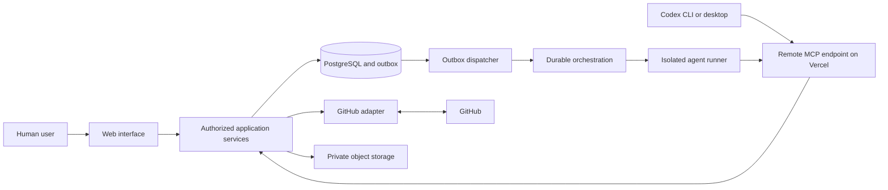

# AI Development Workspace — Technical Specification v0.2

| Field | Value |
| --- | --- |
| Status | Owner-confirmed product decisions; technical/provider validation pending; documentation only |
| Date | 2026-10-16 |
| Initial policy | Supervised automation |
| Architecture | Modular monolith with a separate agent runner |
| Related documents | [README](../../README.md), [project instructions](../../AGENTS.md) |

## 1. Purpose and decision status

AI Development Workspace is a project-management and AI agent coordination system. Users manage multiple software projects and their tasks through a modern Kanban interface, while retaining direct use of Codex through its normal CLI or desktop application. The platform connects task intent to versioned specifications, human decisions, execution evidence, independent review, and GitHub integration.

This is the current architectural source of truth. The owner has confirmed the product and scope choices recorded here; implementation still requires a separate M0 review and authorization. **Required** rules describe product behavior, authority, ownership, and security invariants. **Proposed** choices describe the initial implementation direction; provider capabilities, costs, deployment limits, and integration APIs must be validated before adoption. Listing a technology here does not authorize installation, provisioning, or execution.

The present deliverable is documentation only. Application scaffolding, packages, credentials, cloud resources, and functionality are outside this execution. M0 is not accepted merely because these files exist: architecture review and authorization to begin implementation remain outstanding.

## 2. Product scope and first useful outcome

### Required capabilities

- Projects contain tasks and may have zero or one associated repository initially. Keep the entities separate so multiple repositories can be supported later without redefining tasks.
- A Kanban board shows the seven workflow states, an additional derived On Hold lane, dependency blockers, and pending human actions.
- A task has versioned specifications, explicit approval evidence, directional blocking dependencies, related-task links, manual hold metadata, execution history, artifacts, and an audit timeline.
- Planner, Developer, and Reviewer agents operate with different capabilities and bounded task context.
- The single owner can request low-risk planning directly from their ordinary Codex interface through an authenticated MCP connection, or later explicitly launch supervised implementation runs from the platform.
- Permitted progress reporting and submissions are automated after authorization. Automation does not approve specifications, grant execution authority, or accept implementation.

### First major end-to-end objective

**Create task in web → Ask Codex to plan → Submit specification through MCP → Automatically enter Pending review → Human approval → Ready.**

M1 supplies persistent tasks and human approval. M2 completes this objective through MCP and normal Codex usage. It does not depend on hosted execution, durable orchestration, or full GitHub synchronization.

### Initial exclusions

No autonomous merging, unattended implementation starts, GitHub Projects status synchronization, marketplace for agents, distributed microservice decomposition, or generalized workflow designer is required. Optional autonomy is reserved for M6 and must not weaken mandatory approval or security boundaries silently.

## 3. Architecture and ownership

### Proposed components

| Component | Responsibility | Boundary |
| --- | --- | --- |
| Next.js web application | Project/task UI, Kanban, specification comparison, human decisions, run visibility | Authenticated requests into application services |
| Application services | Authorization, state transitions, approvals, dependencies, run coordination, artifact metadata | Sole business-rule entry point; typed inputs and outputs |
| Supabase PostgreSQL with relational tables and selective JSONB | Durable tasks, dependencies, decisions, execution metadata, audit and outbox | Accessed via server-side application services, never directly by agents |
| Drizzle ORM and Zod | Schema/query integration and runtime boundary validation | Proposed libraries, validated when implementation begins |
| Remote stateless Streamable HTTP MCP endpoint (initially in Next.js/Vercel) | Agent-facing discovery, task-scoped planning, submissions, and reporting | Delegates to the same authorized services as web; local STDIO bridge optional |
| Inngest | Durable dispatch, retries, timeouts, recovery coordination | Proposed orchestrator; database remains authoritative |
| Separate agent runner | Execute authorized runs with Codex SDK/CLI | Isolated execution; no public unrestricted shell endpoint |
| GitHub integration | GitHub App/API calls and verified webhook ingestion | Provider adapter with installation-scoped access |
| Private object storage, initially Supabase Storage | Large logs, diffs, reports, and other artifact contents | Scoped upload/download; no public default access |
| Vercel | Web hosting plus short-lived, stateless remote MCP requests | Long-running agent runner remains separately hosted and validated |

TypeScript and Tailwind CSS are proposed for the web application. The initial deployment uses Supabase Auth with GitHub sign-in, restricted to one owner identified by a stable GitHub provider user ID (not a mutable username). There is no collaboration, membership, or invitation UI. Supabase's OAuth 2.1 server is the preferred *candidate* for remote MCP client authentication; its current beta status, token audience, protected-resource discovery, and Codex interoperability require an M2 spike. A later GitHub App separately governs repository permissions; logging in with GitHub does not grant repository-installation access.

The diagram shows logical dependencies, not a required count of deployments. Web, MCP, and background service entry points may share server-side modules. Long-running agents must not rely on a web request remaining open. A separate runner may use a worktree within an isolated process/container environment; a worktree alone only isolates files and branches.

### Required source-of-truth boundaries

| Authority | Owns | What the platform retains |
| --- | --- | --- |
| Supabase PostgreSQL | Projects, tasks, dependencies, holds, specifications, decisions, grants, workflow states, execution metadata | Authoritative business records; relational core with JSONB extensions |
| GitHub | Repositories, branches, commits, pull requests, CI results | External IDs, observed snapshots, timestamps, and evidence references |
| Object storage, initially Supabase Storage | Large artifact contents | Database metadata, checksum, ownership, retention and storage key |

GitHub observations are reconciled facts, not independent workflow commands. A merged PR does not itself make a task Done. GitHub Projects must not become a duplicate authoritative task-status store. Orchestrator history and local Codex chat history likewise do not replace platform records.

## 4. Task workflow

### States and entry meaning

| State | Meaning and entry conditions |
| --- | --- |
| Backlog | Captured task; scope may be incomplete; no execution implied |
| Specification | Requirements are being clarified and a specification is being prepared |
| Pending review | A complete, immutable specification version has been submitted for human review |
| Ready | An authorized human approved the current exact specification version; execution has not started |
| In progress | Explicitly authorized implementation has begun against that version |
| Review | Implementation evidence has been submitted against a fixed revision; acceptance is pending |
| Done | Applicable independent review, human acceptance, verification, and integration conditions are satisfied |

### Dependencies, related tasks, and On Hold

**The seven workflow states remain authoritative.** On Hold is a *separate, manually controlled pause condition*, not an eighth state. The Kanban may project held tasks into an additional `On Hold` column or view; each held card must display its underlying workflow stage. Resuming restores its display to that stage without inventing a transition or losing history. Holds record who paused the task, a required reason, timestamps, and the release event.

A directional `blocks` dependency expresses precedence: task A must reach Done before task B may start implementation or satisfy completion guards. A separate `relates_to` link expresses association without restricting execution. Initially these links are within one project. Reject self-links, duplicates, and dependency cycles. Dependencies can be planned before their prerequisites finish: an otherwise approved task may remain **Ready · Blocked by BIW-21**, with its implementation action disabled. Completing a prerequisite removes the blocker once all relevant guards pass; it does not automatically launch implementation under Supervised automation.

Do **not** automatically mark a dependency-blocked task On Hold. Use On Hold when the owner deliberately pauses it for a reason other than normal precedence. While held, new planning submissions, approvals, implementation starts, reviews and completion transitions are blocked until the owner resumes or follows an explicit cancellation/revision flow. An active managed run must be canceled and safely fenced before a hold becomes effective; local Codex activity outside platform control cannot be forcibly stopped and must be described honestly.

The UI must expose dependency direction, linked/related tasks, hold reason, current stage, and a recorded history of both linking and hold/resume. No free drag-and-drop may bypass status rules or hold guards.

### Allowed transitions

All transitions below require authorized owner/service identity, the current task revision, no active hold, and a recorded reason or evidence. Any unlisted transition is rejected. Agent capabilities are scoped to assigned tasks/runs; no generic agent `set_status` capability exists.

| From → To | Permitted actor | Guard and effect |
| --- | --- | --- |
| Backlog → Specification | Authenticated owner through the web or a permitted task-scoped MCP planning request | Register a bounded planning session; no separate dashboard approval is required for interactive planning |
| Specification → Backlog | Authorized human | Defer with reason; stop any active planning grant/run |
| Specification → Pending review | Assigned Planner or authorized human | Submit a valid immutable specification version; store version and transition atomically |
| Pending review → Specification | Authorized human | Reject/request changes with reason; retain rejected version and decision |
| Pending review → Ready | Authorized human only | Approve the exact current submitted version; approval and transition are atomic |
| Ready → Specification | Authorized human | Scope revision or withdrawal; invalidate execution eligibility and retain prior approval history |
| Ready → In progress | Authorized service acting on a human execution grant | Approved version still current; dependencies satisfied; grant valid; runner start acknowledged; one active implementation run |
| In progress → Review | Assigned Developer or authorized human | Submit implementation revision, acceptance mapping, tests and artifacts; freeze review target |
| In progress → Ready | Authorized human | Stop/retry without scope change; revoke current grant and fence the run before transition; fresh authorization needed |
| In progress → Specification | Authorized human | Scope change; revoke grants, cancel/fence active run, supersede specification eligibility |
| Review → In progress | Authorized human execution/rework grant, applied by service | Record rejection/rework reason; same approved scope; bind fresh grant to new attempt |
| Review → Specification | Authorized human | Review uncovers scope change; supersede eligibility and require a new specification approval |
| Review → Done | Authorized human only | All completion guards below pass against the current review target |
| Done → Specification | Authorized human | Reopen with reason for reassessment; old completion evidence remains historical |

A Reviewer submits findings and a recommendation while the task remains Review. Findings never directly approve, merge, or start rework. Human rejection of implementation may leave the task in Review with requested changes until a human authorizes rework, or return it to Specification when scope changes.

### Approval and execution invariants

1. A specification approval references its immutable version ID and content hash. Approval of version N never authorizes N+1. A new submitted version requires returning through Specification; submitted content cannot be silently edited in Pending review or Ready.
2. Ready indicates specification approval, not permission to run. A separately stored `execution_grants` record specifies task, approved version, agent role/profile, repositories, allowed operations, time limits, and execution attempt. It is not an approval row. Approval and authorization may share a UI flow only if they remain explicit, separate recorded actions.
3. A grant is consumed for one run/attempt. Delivery retries reuse that run and do not create another authorization. New attempts or rework require fresh authorization under the initial policy.
4. Pending dependencies block execution, even if a specification is approved. Dependency completion must be checked at dispatch and runner start. A later dependency reopen blocks further submissions/completion until a human resolves the impact.
5. A run that fails, expires, or is canceled does not silently rewind the task. An In progress task remains visibly blocked with a terminal run outcome until a human authorizes the documented recovery path.
6. Specification supersession and revocation are enforced server-side even if a runner or local session continues. Such a run may report its terminal status, but cannot submit accepted implementation against the stale grant.

### Done criteria

- The submitted implementation maps to the approved specification and acceptance criteria.
- Required verification has current evidence; failing, missing, or stale evidence blocks completion. Before CI integration, explicitly recorded local verification may fulfill the task's declared checks.
- An independent Reviewer has evaluated changes, tests, criteria, and risks; unresolved blocking findings prevent acceptance. An agent review is advisory; an authorized human records final acceptance.
- Review and acceptance refer to the exact submitted commit/diff digest. Any change invalidates those decisions until re-review; a new PR head or incompatible integration result must be reassessed.
- All required dependencies are satisfied.
- For code tasks requiring GitHub integration, required checks and reviews pass and the approved work is merged into the designated target branch. The observed merge and revision mapping are recorded. No automatic merge authority is assumed.
- For documentation, planning, or other tasks where integration does not apply, the human records why the criterion is not applicable and which deliverable was accepted. Applicability is declared in the specification, not inferred by an agent after a failed check.

## 5. Roles, identity, and execution lifecycle

| Role | Responsibilities | Restrictions |
| --- | --- | --- |
| Planner | Read requirements and permitted repository context; produce and submit technical specifications | Cannot approve specifications or authorize implementation |
| Developer | Implement the approved specification in an isolated workspace; report progress and verification evidence | Cannot approve its specification or implementation; cannot expand granted repository/tool scope |
| Reviewer | Independently assess the fixed implementation revision, tests, acceptance criteria, and risks | Must not be the implementation run/identity; findings are not human acceptance |

The initial product is deliberately **single-owner**. Only the configured, stable GitHub account identity may enter the workspace; there are no member roles, invitations, organizations, or collaboration UI. Record the owner identity for audit, and check it server-side on every human operation. Separate this human identity from task/run-scoped agent service identities. A future multi-user model would require an explicit architecture revision, not speculative access tables today.

The owner may ask Codex to plan a task directly. An authenticated MCP call to `begin_planning` creates a low-privilege, task-scoped planning session after checking ownership and task eligibility; **no second per-task dashboard approval is required**. Submission requires that session. Authentication proves which configured client/user is connected; a model-invoked tool call does not cryptographically prove the owner typed the immediate instruction, so its planning permission must remain narrow. No MCP tool can approve work or authorize autonomous implementation. External Codex activity that has not registered an authorized session is not assumed to be managed or observable by the platform.

### Agent-run status (separate from task state)

Proposed run states: `queued`, `starting`, `running`, `cancel_requested`, `succeeded`, `failed`, `canceled`, `timed_out`. Normal progression is queued → starting → running → succeeded/failed. Any nonterminal run may receive a cancellation request and finish canceled; deadline expiry produces timed_out after fencing the execution. Startup failures can end failed without reaching running.

Run success means its output was validly submitted, not that a human accepted the task. A Planner run can succeed when a task enters Pending review; a Developer run can succeed while a task is in Review. Status updates must follow the run lifecycle, carry a monotonic sequence, and reject stale or illegal terminal-state rewrites.

A lease token/generation identifies the current runner attempt. Heartbeats update liveness; they do not authorize longer execution or additional tools. Terminal runs retain results and failure classification. A new execution attempt is a new run linked to its predecessor and fresh human grant, while transport retries preserve run identity.

## 6. Data model and integrity

IDs are opaque stable identifiers. Records use UTC timestamps, explicit ownership, foreign keys, and indexed access paths appropriate to project/task queries. Exact physical schema and indexing will be chosen with migrations in the implementing milestone; the following responsibilities and relationships are required.

| Entity | Responsibilities and key relationships |
| --- | --- |
| `users` | Single authenticated owner, recorded under the stable GitHub provider user ID; audit identity, not a multi-user collaboration system |
| `projects` | Name, key, owner, settings and task grouping; zero or one active repository initially, with relation modeled separately for future expansion |
| `project_repositories` | Separate project ↔ repository association with normalized URL, eventual stable GitHub repo ID, target branch, installation/access state; enforce maximum one active link per project initially, with future expansion designed in |
| `tasks` | Project, human-readable key, title, description, seven-state status, optional manual hold flag/reason/by/time, optimistic revision, current specification/review target; inherited default repository; not a copy of PR status |
| `task_specifications` | Task, monotonically increasing version, immutable submitted content/hash, author and submission time; unique `(task_id, version)`; includes criteria, non-goals, plan, tests, risks, affected repositories, integration applicability |
| `approvals` | Immutable human decisions for specification approval/rejection and implementation acceptance, binding actor, task, exact specification FK/hash or review digest, reason and timestamp; never stores execution capabilities | 
| `execution_grants` | Separate, revocable, expiring single-attempt authorization with task, approved specification, agent profile, allowed repositories/tools/operations, run scope and consumption state; introduced with M3 |
| `agent_profiles` | Planner/Developer/Reviewer identity, permitted capabilities and runtime configuration; no plaintext secrets; runs snapshot the selected configuration |
| `agent_runs` | Task, role/profile snapshot, exact specification when applicable, bound `execution_grants` or scoped interactive planning session, lifecycle, lease, heartbeat, deadline, repository baseline, output revision, error summary and predecessor; no task-state substitution |
| `task_events` | Append-only audit timeline: actor identity/type, action, before/after state/revision, specification/run IDs, reason, correlation/idempotency key and timestamp; stores references rather than unredacted sensitive payloads |
| `task_dependencies` | Directed blocking task → prerequisite edges within one project initially; reject self-links, duplicates and cycles; creation/removal auditable | 
| `task_relations` | Nonblocking `relates_to` links between tasks in the same project initially, with duplicate/symmetric-link normalization; changes auditable |
| `github_links` | Task/run ↔ repository, branch, commit or PR references, observed head/merge/check facts and last reconciliation time; external authority remains GitHub |
| `artifacts` | Task/run, content type, size, checksum, storage key or controlled external reference, producer, upload/verification state and retention; large contents remain outside PostgreSQL |
| `outbox_events` | Transactionally recorded integration/orchestration intent, event type/schema version, aggregate/revision, delivery attempts, availability and delivery outcome; not a replacement for audit events |

A minimal owner identity and credential/planning-session record may be added as needed; do not build project-membership, invitations, organizations, or team-role management under the single-user scope. Use normal relational fields and constraints for task status, owner, dependencies, approval version, and grants; reserve PostgreSQL JSONB for extensible settings, metadata, structured reports, and sanitized event payloads, not the whole workflow. Prefer explicit typed decision/grant variants over ambiguous approval booleans. Cross-record checks must prevent a specification, repository, run, or approval from another task/project being attached by ID.

### Transactional rules

- State mutation reads the expected task revision and relevant approval/dependency evidence, then writes the task revision increment, audit event, and required outbox event in one transaction. Optimistic conflicts return a conflict result; clients refresh instead of overwriting.
- Enforce at most one active Developer run per task. Consume an execution grant and create its run/outbox intent atomically. A unique constraint backs the service check.
- Dependency graph edits require serialization within the project so simultaneous additions cannot create a cycle. Execution guards and changes to eligibility use a consistent locking/revision scheme to prevent a check-then-start race.
- Version allocation and specification submission are transactional. An approval request includes the reviewed version and expected revision; concurrent submissions or revocations cannot approve an unseen version.
- Preserve historical approvals and specifications. Mutable eligibility pointers do not erase history. Retention/deletion semantics must be settled before production personal-data handling.

## 7. MCP interface

### Transport and authority

Required: AI agents communicate through the custom MCP server, never with database credentials or direct SQL. MCP handlers validate inputs and invoke the same application services as the web interface, with a server-derived principal and project/task scope. IDs and actor names supplied by a model do not establish identity.

**Preferred initial production MCP:** deploy a **stateless Streamable HTTP** endpoint in the same Next.js application on Vercel (e.g. `/api/mcp`). MCP handlers delegate to shared application services; they never run coding agents or hold long-lived in-memory sessions. All durable planning/task/run context lives in PostgreSQL. Vercel's documented MCP route-handler support must be validated with the actual Codex client and authorization flow at M2. A standalone hosted MCP service is not required initially, but remains an adapter/deployment option.

**Authentication:** Supabase Auth with GitHub sign-in is used for the single-owner web application. For the remote MCP client OAuth flow, investigate Supabase Auth's OAuth 2.1 authorization-server functionality (currently beta), including protected-resource metadata, OAuth discovery, client registration/consent, PKCE, token audience and expiration, owner-only enforcement, and Codex CLI/desktop interoperability. **GitHub social sign-in alone does not implement MCP client authorization.** Do not put Supabase service keys or privileged database tokens in Codex configuration. Production HTTP access must be encrypted, scoped, revocable, and audience-validated.

**Fallback:** if that combination is not proven interoperable or acceptable, use a thin local STDIO bridge with a secure, revocable owner credential to the same remote application API. STDIO is optional and is not the default architecture. Codex planning must work while the owner's computer hosts only the client, not the platform server.

### Common contract

All tool inputs and outputs have runtime schemas and typed service equivalents. Discovery uses bounded pagination and project-scoped filters. Mutations require an idempotency key; state-affecting operations also require `expected_task_revision`. Server identity determines actor, assignment, and permissions. Run writes include `run_id` and a valid lease/session binding; timestamps alone are not ordering tokens.

Successful results return relevant IDs, current revision, status, and durable receipt/event ID. Errors distinguish `invalid_input`, `unauthenticated`, `forbidden`, `not_found`, `conflict`, `precondition_failed`, `rate_limited`, and retryable `unavailable`. Do not disclose inaccessible records through error details. Reusing an idempotency key with a different payload is a conflict; exact retries return the original receipt.

### Initial tools

| Proposed tool | Required input | Output and service effect |
| --- | --- | --- |
| `list_projects` | Optional cursor and bounded limit | Owner-accessible project summaries and next cursor; read only | 
| `begin_planning` | Task key/ID, expected revision, idempotency key | Checks owner connection, existing hold and task eligibility; creates a bounded planning session and enters Specification when permitted; no extra dashboard approval for low-risk planning |
| `list_tasks` | Optional project ID and filters including state/held/blocked/cursor/limit | Owner-accessible task summaries, relationships, blockers and revisions; read only |
| `get_task_context` | Task key/ID; optional artifact/context pagination | Requirements, workflow/revision, current specification/version, dependency/related links, manual holds, repository references, scoped evidence and allowed next actions |
| `submit_specification` | Task ID, expected revision, idempotency key, authorized planning session/run, structured specification | Validate completeness, persist immutable version, move Specification → Pending review atomically; return version/hash/revision |
| `get_approved_specification` | Task ID; optional requested version/run | Exact approved content/hash and effective approval/eligibility; no eligible approval returns a precondition error; historical retrieval is clearly labeled and never implies execution permission |
| `report_execution_progress` | Task/run IDs, lease/session binding, monotonic sequence, idempotency key, lifecycle/progress message | Persist bounded progress/heartbeat and permitted run lifecycle changes; never arbitrary task-state mutation |
| `submit_implementation` | Task/run IDs, lease, expected task revision, idempotency key, specification version, revision/diff digest, acceptance mapping, verification and artifact references | Validate current grant and evidence; persist result and move In progress → Review atomically; mark Developer run succeeded |
| `submit_review_result` | Task/review-run IDs, lease/session binding, expected task revision, idempotency key, reviewed digest, findings, checks and recommendation | Persist independent review against fixed target; complete Reviewer run; task remains Review |
| `register_artifact` | Task/run IDs, idempotency key, kind, size/type/checksum, permitted upload reference | Create/confirm artifact metadata and scoped upload intent; only verified completed uploads become accepted evidence |

Specification payload requires problem, scope/non-goals, acceptance criteria, affected repositories, proposed approach, verification, risks, and integration applicability. Missing mandatory content fails validation without changing state. Tool descriptions and errors must tell agents which human action is needed when a gate blocks them.

No initial MCP tool can approve a specification, grant autonomous implementation, mark Done, merge, release a human-imposed hold, or broaden permissions. Human actions use authenticated human application flows. Artifact registration cannot fetch arbitrary model-supplied URLs or trust an upload's claimed checksum without verification.

### Repository discovery before full GitHub integration

In M1 the owner registers at most one repository URL per project (or none). In M2 interactive Codex reads its local Git remotes, canonicalizes their identities, and compares them with the task's registered repository. A mismatch, missing checkout, ambiguous remote, or inaccessible repository requires explicit resolution rather than silent workspace selection. The local path is client-specific and must not become the authoritative repository identity. M4 introduces GitHub App-backed repository selection, stable IDs, installation permissions, and webhook reconciliation. Multi-repository execution remains deferred.

## 8. Supervised execution and orchestration

1. The owner chooses a task, approved version, Developer profile, linked repository, and bounded execution scope. The service checks owner permission, state, absence of hold, and dependencies; it creates a separate `execution_grants` row plus queued run, audit event, and dispatch outbox event atomically.
2. The dispatcher publishes the run intent to the proposed orchestrator. Delivery can repeat; `(event_id, run_id)` deduplication prevents duplicate execution.
3. The runner claims a lease and rechecks grant validity, current version, dependencies, installation access, deadline and baseline. A canceled or superseded run cannot start on a delayed message.
4. Create an isolated workspace at recorded base commits, with bounded credentials, tools, filesystem/network access and resource limits. Bind callback credentials to the run. The service enters In progress only when the authorized start is acknowledged; queued/starting runs remain visible separately.
5. Execute Codex through a validated SDK/CLI integration. Stream redacted, bounded progress and store large logs privately. Report only facts that the runner can substantiate.
6. Submit the exact result revision/digest, criteria mapping, checks, artifacts and known limitations through services/MCP. Atomically enter Review and finish the run. Submission does not merge or accept work.
7. A separately authorized Reviewer invocation evaluates that target. The human handles findings, authorizes rework if needed, and records acceptance/integration decisions before Done.

Inngest is the proposed durable orchestration engine, not an authorization authority. Its retry policy must distinguish safe delivery retries from starting another billable execution. The runner must not execute an unbounded task merely because an orchestration retry fired.

Direct local Codex use and hosted execution share contracts but have different control boundaries. The platform can revoke local MCP writes; it cannot guarantee termination of an independently launched local process. The UI must show this distinction and avoid claiming local execution isolation that the platform does not control.

## 9. GitHub integration

Use GitHub authentication for identity and a GitHub App for repository permissions. Select minimum installation permissions needed by each milestone; exact permission names/scopes and token lifetimes are validated during M4. Do not hand an installation-wide credential to an agent when a narrower runner/service operation suffices.

Persist stable installation/repository/PR IDs and reconcile renamed repositories. Link each implementation to its base commit, branch, head revision and target branch. PR creation and updates require the run's granted scope; merging remains a separately authorized human operation. A provider outage or revoked installation blocks integration and completion, while preserving local evidence.

Webhook ingestion verifies the signature over raw bytes before parsing or acting, limits payload size, validates event type and installation/project mapping, and deduplicates delivery IDs. A valid signature authenticates provider delivery, not permission for arbitrary workflow transitions. Persist relevant receipt/effect atomically and acknowledge promptly; process expensive reconciliation asynchronously.

Refresh authoritative PR/check state before final acceptance. Out-of-order webhook deliveries must not overwrite newer observations. A PR head change invalidates prior review evidence. A merged PR must be mapped to the reviewed changes and designated target; unexpected merge content or target changes require human reassessment. Periodic/on-demand reconciliation repairs missed webhooks.

## 10. Reliability, security, and recovery

| Concern | Required behavior and verification target |
| --- | --- |
| Human gates | Human-only decision endpoints verify current identity, permission, reviewed version and expected revision; test agent attempts and stale approval rejection |
| Authentication and authorization | Enforce project/resource checks for web, MCP, runner callbacks and artifact access; protect cookie-authenticated mutations against CSRF; verify cross-project denial |
| Agent credentials | Short-lived task/run/role scope, server-side revocation, no raw database/admin tokens in prompts, logs or repository; test revoked/expired scope |
| Isolation | Worktree for Git separation plus enforceable process/sandbox controls for untrusted execution; bound filesystem, network, secrets, resources and cleanup; validate runner escape boundaries before hosted use |
| Idempotency | Persist mutation key and payload identity with its effect; unique consumer receipts; retry duplicate grants, submissions, webhooks and dispatch without duplicate work |
| Retry policy | Bounded backoff for transient transport/provider errors; no blind retry of authorization, validation, or unknown non-idempotent outcomes; reconcile external outcomes before repeating |
| Concurrency | Revision checks, unique active-run constraint, serialized dependency changes, lease fencing and atomic eligibility checks; test simultaneous approvals, starts and supersession |
| Transactional publication | Commit outbox intent alongside state/audit; dispatcher retries until acknowledged, consumers deduplicate; expose exhausted delivery for recovery |
| Audit | Append-only business events for transitions, decisions, grants, revocations, run outcomes and provider actions; correlate human/task/run/event; redact secrets and restrict audit access |
| Cancellation/timeouts | Record intent, revoke capability/lease, request cooperative stop then terminate controlled processes at deadline; stop accepting fenced output; preserve partial evidence safely |
| Sensitive data | Encrypt transit and provider-managed storage, minimize retained prompts/logs, redact before persistence, use private signed artifact access; establish retention/export/deletion policy before production |
| Webhooks | Verify raw-body signatures and installation scope, deduplicate, tolerate reordering; invalid delivery has no business effect |
| Recovery | Detect expired heartbeat/lease, reconcile durable run and external effects, preserve evidence, terminalize uncertain attempts and require human authorization for a new execution |

### Failure handling and operational behavior

- If the database is unavailable, refuse mutations; do not acknowledge a submission that was not committed.
- If publishing fails after a transaction, leave the outbox pending and retry delivery. If acknowledgement is lost, deduplication resolves the repeated event.
- If a runner disappears, fence its lease and show an interrupted/failed or timed-out run after reconciliation. Never run two Developers because a heartbeat was delayed.
- If an external API succeeded but the response was lost, reconcile using recorded provider identifiers before attempting creation again. Surface unresolved outcomes for human recovery.
- Uploads remain pending until content/size/checksum verification succeeds. Clean orphan uploads through a retention policy; incomplete content cannot satisfy acceptance evidence.
- Cancellation racing with completion is serialized by the current run/task revision and lease. A rejected late submission remains diagnostic evidence, not accepted implementation.
- Persist integration/check freshness. Unknown, missing, stale, or pending checks are not successful checks.

Observability should expose run durations, failures, queue/outbox lag, webhook errors, conflicts, and permission denials with correlation IDs. User-visible status distinguishes waiting for human action, blocked dependencies, queued work, failed execution, and failed integration without adding extra task states. Alerts and recovery actions must be actionable and avoid sensitive payloads.

Before production, validate backups and restore with a documented recovery exercise; set explicit retention, recovery time/data-loss objectives, budgets, and timeout/resource limits. These values require operational evidence rather than invented guarantees in this draft.

## 11. Validation strategy

Validation is introduced with the milestone that implements the behavior. There are no test commands in this documentation-only repository yet.

- Service tests cover the transition matrix, actor permissions, specification versioning, evidence freshness, dependency rules and prohibited self-approval.
- PostgreSQL integration tests exercise approval/start races, transactional outbox writes, idempotency, tenant isolation and lease fencing using actual constraints.
- MCP contract tests cover schema errors, scoped discovery, forbidden human operations, exact retry receipts, and submission-driven transitions.
- End-to-end tests first prove task creation → local Codex planning → MCP submission → Pending review → human approval → Ready. Rejected and superseded versions must fail the corresponding guards.
- Runner/provider tests exercise interrupted starts, duplicate delivery, cancellation, stale callbacks, lost API responses, webhook forgery/reordering, and recovery.
- UI verification includes keyboard-accessible Kanban alternatives, clear transition failures, specification version comparison, explicit human actions, and honest loading/error/blocked states.

Mocks can isolate provider adapters, but do not prove actual Codex, MCP, Inngest, Neon, Vercel, or GitHub interoperability. Each adopted provider requires a bounded integration validation in its milestone.

## 12. Development milestones

Each milestone is independently reviewable. Implementation begins only after a separate request following specification review. Changes should establish the smallest working path with its verification, then stop for review before expanding scope.

| Milestone | Deliverables | Acceptance criteria |
| --- | --- | --- |
| **M0 — Architecture and repository foundation** | Reviewed specification, concise repository instructions, agreed implementation boundaries; minimal application/tooling setup only when subsequently authorized | Human review resolves blocking design questions; repository instructions reflect real structure and validated setup/build/check commands once created; no cloud provisioning implied by documentation acceptance |
| **M1 — Project and workflow foundation** | Supabase PostgreSQL and owner-only GitHub login, repository URL mapping (zero/one per project), tasks, global and project boards, approval inbox, derived On Hold lane, directional blockers and related-task links, immutable specifications, human decisions, audit/outbox primitives | Unauthenticated or non-owner access is denied; two projects have separate boards; held/blocked tasks cannot start incorrectly; cycles fail; stale approval fails; owner approval moves an exact submitted version to Ready; history persists and database tests pass |
| **M2 — Codex through MCP** | Preferred stateless remote MCP endpoint on Vercel with owner-authenticated client access via validated Supabase OAuth 2.1 server flow; task-scoped `begin_planning`, repository identity check, context retrieval and automatic specification submission; STDIO bridge only if interoperability blocks remote approach | Demonstrate normal Codex CLI/desktop planning against hosted app while no local server runs; one initial owner sign-in is acceptable, no per-task dashboard confirmation; invalid submission leaves state unchanged; exact retry creates one version/event; agent cannot approve or release holds; no agent database credentials |
| **M3 — Supervised execution** | Explicit owner-authorized `execution_grants`, separate isolated runner, Codex SDK/CLI adapter, proposed durable orchestration, leases, progress, Supabase Storage artifacts, cancellation and recovery | Approved task starts only with a valid unconsumed grant and no active hold/dependency blocker; duplicate dispatch runs once; stale version/revoked grant cannot start or submit; interrupted run is visible and recoverable; valid implementation enters Review without human acceptance |
| **M4 — GitHub and independent review** | GitHub App, verified webhooks, PR/revision/check links, separately authorized Reviewer runs, human acceptance and integration guards | Forged/repeated/out-of-order webhooks have safe effects; Developer cannot approve itself; changed head invalidates review; required failing CI or missing merge blocks Done; accepted, reviewed, integrated target can reach Done |
| **M5 — Production readiness** | Threat review, hardened deployments, access and secret lifecycle, operational metrics/alerts, backup/restore, retention, timeout/cancellation and failure recovery runbooks | Security boundary tests pass; restore and interrupted-run recovery are demonstrated; budgets/limits and operational objectives are agreed; private artifacts remain scoped; production deployment receives explicit authorization |
| **M6 — Optional autonomy and providers** | Explicit configurable policy boundaries and additional agent adapters only when justified | Human opts into specific capabilities; audit explains policy-based actions; default stays Supervised automation; cross-provider contracts and existing gates remain verifiable; no implied blanket merge or deployment authority |

M0 documentation preparation is the current activity, not evidence that M0 implementation or any later milestone has been delivered. M2 is the first major end-to-end product objective; M3–M6 are not prerequisites for that planning-and-approval loop.

## 13. Provisional decisions and review questions

| Decision to validate | Initial direction | Resolution point |
| --- | --- | --- |
| Project collaboration scope | **Decided: single owner only**, GitHub sign-in via Supabase Auth, allowlist by stable provider ID; no team features | Implement M1 owner verification |
| Database and hosting | **Decided: Supabase PostgreSQL + selective JSONB**, Drizzle/Zod; Vercel for web, Supabase Storage candidate; no versions pinned | M0/M1 provider and connection validation |
| Interactive planning policy | **Decided: Option B** — authenticated Codex `begin_planning` without per-task dashboard approval; narrow planning capability and audit | M2 security/UX validation |
| Remote MCP deployment and auth | **Preferred: stateless Streamable HTTP in Next.js on Vercel**; Supabase Auth OAuth 2.1 server (beta) candidate; STDIO fallback | Prove OAuth discovery, Codex interoperability, audience and persistence behavior at M2 |
| Hosted runner location and sandbox | Separate runner with enforceable isolation; worktrees inside that boundary | M3, before executing untrusted code |
| Durable orchestration | Inngest proposed; validate leases, retry/cancel behavior and hosting fit | M3 |
| Codex invocation API | SDK/CLI proposed; validate identity, headless execution, permissions and evidence capture | M2 for local, M3 for runner |
| GitHub permissions and merge evidence | Minimum GitHub App permissions; human merge authority; revision-bound checks/review | M4 |
| Storage and operations | Supabase Storage preferred candidate; retention, deletion, budgets and recovery objectives not yet set | Validate in M3; finalize before M5 production |

**Owner-confirmed UI and workflow scope:** keep global Overview, per-project Kanban, Approvals inbox, task details and audit history. Show an additional On Hold board projection without adding a workflow status. Do not allow arbitrary drag-and-drop; all transitions use explicit validated actions. Use one active repository per project initially, with separate entities and future extensibility. Human decisions and execution grants are separate records.

**Research references for subsequent engineering validation:** [Supabase GitHub sign-in](https://supabase.com/docs/guides/auth/social-login/auth-github), [Supabase OAuth 2.1 server (beta)](https://supabase.com/docs/guides/auth/oauth-server), [Supabase MCP authentication](https://supabase.com/docs/guides/auth/oauth-server/mcp-authentication), [Vercel MCP hosting](https://vercel.com/docs/mcp/deploy-mcp-servers-to-vercel), and the [MCP authorization specification](https://modelcontextprotocol.io/specification/2025-11-25/basic/authorization). Documentation supports feasibility but does not substitute for an integration test.

Provider validation may revise a provisional choice through a documented human-reviewed change. It must not silently alter the required approval gates, source-of-truth boundaries, or supervised execution policy.
